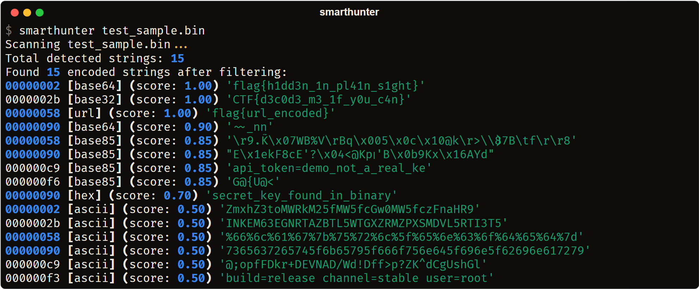
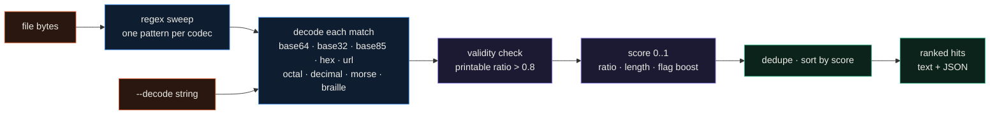

<div align="center">

# SmartHunter

**Scan a file for hidden strings and flags: it tries 11 encodings on every region, decodes what looks real, scores each hit, and prints them ranked by confidence.**




</div>

CTF binaries and firmware images hide the interesting bytes behind an encoding: a flag sitting in base64, a key in hex, a token in base85. I wrote SmartHunter to try all of those at once. It runs each encoding's pattern across the file, decodes every match, scores how much the result looks like a real string (and boosts anything shaped like `flag{...}`), then ranks the hits so the planted secret tends to land at the top.

## Highlights

- One pass over a file tries 11 encodings: ASCII/cleartext, standard and URL-safe base64, base32, base85, hex, percent/URL, octal, decimal, Morse and Braille.
- Each hit gets a 0-to-1 confidence score from the printable-character ratio and length, with a boost when the decoded text matches a flag pattern (`flag{}`, `CTF{}`, `KEY{}`, or any `{...}` of five or more characters).
- The same region often decodes several ways, so the output shows each interpretation with its score. In the image above, one region appears both as raw base32 text (0.50) and as the decoded `CTF{...}` flag (1.00).
- `--clean` keeps only hits at 0.80 and up, `--threshold` sets any cutoff, and `--min`/`--max` bound the decoded length.
- `--decode "<string>"` runs the same decoders on a single string you paste, instead of scanning a file.
- `--out results.json` writes every hit (offset, length, codec, text, score) as JSON. The scanner is also importable: `from smarthunter import scan_file`.

## How it works



## Results

The image is a real run on `test_sample.bin`, a 284-byte file (built by `scripts/make_sample.py`) that hides six short messages in different encodings. SmartHunter found 15 candidate strings and ranked them:

| Offset | Codec | Score | Decoded |
|---|---|---|---|
| `0x00000002` | base64 | **1.00** | `flag{h1dd3n_1n_pl41n_s1ght}` |
| `0x0000002b` | base32 | **1.00** | `CTF{d3c0d3_m3_1f_y0u_c4n}` |
| `0x00000058` | url | **1.00** | `flag{url_encoded}` |
| `0x000000c9` | base85 | 0.85 | `api_token=demo_not_a_real_ke` |
| `0x00000090` | hex | 0.70 | `secret_key_found_in_binary` |
| `0x00000002` | ascii | 0.50 | `ZmxhZ3toMWRkM25fMW5fcGw0MW5fczFnaHR9` |

The three planted flags come out on top because the flag-pattern boost pushes them to 1.00. The lower rows are the honest rest of the picture: the base64 region also shows up as raw ascii at 0.50, the hex key scores 0.70, and base85 (whose alphabet overlaps the other encodings) produces a few low-confidence matches on regions that were not base85 to begin with. That is what `--clean` and `--threshold` are for.

```bash
$ python scripts/make_sample.py
wrote test_sample.bin (284 bytes)

$ smarthunter test_sample.bin --clean
Scanning test_sample.bin...
Total detected strings: 15
Found 8 encoded strings after filtering:
00000002 [base64] (score: 1.00) 'flag{h1dd3n_1n_pl41n_s1ght}'
0000002b [base32] (score: 1.00) 'CTF{d3c0d3_m3_1f_y0u_c4n}'
00000058 [url] (score: 1.00) 'flag{url_encoded}'
```

## Quickstart

```bash
git clone https://github.com/EllE961/smarthunter.git
cd smarthunter
pip install -e .                 # installs rich and typer

python scripts/make_sample.py    # writes the 284-byte demo file
smarthunter test_sample.bin      # scan and rank everything it finds
smarthunter test_sample.bin --clean          # only hits scoring >= 0.80
smarthunter test_sample.bin --threshold 0.9  # custom cutoff
smarthunter test_sample.bin --out hits.json  # also write JSON

smarthunter --decode "%66%6c%61%67%7b%75%72%6c%5f%65%6e%63%6f%64%65%64%7d"
```

From Python:

```python
from smarthunter import scan_file

hits = scan_file("firmware.bin")          # list of dicts, sorted by score
flags = [h for h in hits if "flag{" in h["text"].lower()]
for h in flags:
    print(f"0x{h['offset']:08x} {h['codec']} {h['text']}")
```

## Repository map

```text
src/smarthunter/
  main.py          the smarthunter command: read file, sweep 11 codecs, score, rank, JSON out
  __init__.py      exposes scan_file()
  core.py          a separate chunked mmap + multiprocess scanner (not wired to the CLI)
  _finder.pyx      optional Cython URL finder used by core.py, with a pure-Python fallback
  decoders/        pluggable decoder classes used by core.py
scripts/make_sample.py   builds test_sample.bin, the file in the image
test_decode.py     decode_string checks for url, hex and base64
```

## Limitations

- The detectors are regex plus a decode attempt, so they produce false positives. Base85 is the worst offender: its alphabet covers the characters that hex, base64 and base32 regions use, so it matches and "decodes" those regions into low-confidence noise. Scan with `--clean` or a `--threshold` to cut it.
- The installed `smarthunter` command (`main.py`) reads the whole file into memory and runs single-process. The chunked, memory-mapped, multiprocess scanner in `core.py` is a separate engine that the CLI does not call.
- Output is UTF-8. On a legacy Windows console that cannot encode a decoded byte, rich can raise while printing; run it in a UTF-8 terminal or use `--out` to capture JSON.
- Morse and Braille need the input already written as dot/dash or Unicode Braille cells; there is no audio or image step.

## License

MIT. See [LICENSE](LICENSE).
